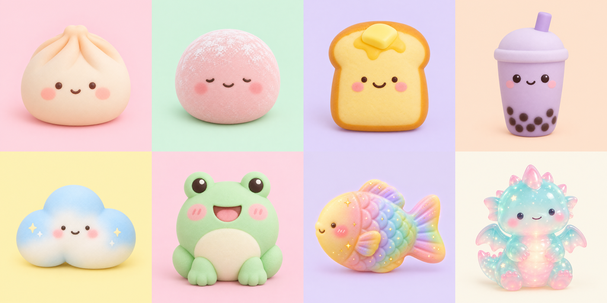
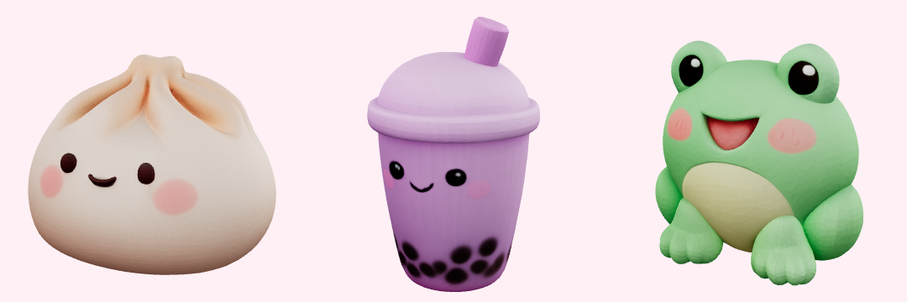

# Сквиш-фабрика (roblox-squish)

Игра для Roblox в жанре «собирай редкое, кради у других, защищай базу».
Вместо яиц здесь сквиши: мягкие игрушки-еда с лицами, все персонажи свои.

Рабочее название меняется в одном месте: ключ `brand.name` в
`src/shared/Strings.luau`, на всех четырёх языках.



## Как играется

- **Коробки с сюрпризом.** В центре площади стоит машина с коробками. Платишь
  монетами, коробка трясётся, лопается, выпадает сквиш. Первая коробка
  бесплатная, и в ней всегда Пельмешек.
- **Полки.** Сквиш встаёт на полку у тебя в базе и приносит монеты каждую
  секунду. Нажатие на сквиша продавливает его («сжатие») и даёт ещё монет.
- **Слияние.** Два одинаковых сквиша одного уровня сливаются в одного большого
  следующего уровня. Он приносит больше, чем двое по отдельности, и
  освобождает полку.
- **Кража с физикой.** Можно зайти в чужую базу и утащить сквиша. Он тяжёлый
  (вор идёт медленнее), скользкий (может выпрыгнуть из рук) и скучает по дому
  (в 30% случаев убегает обратно уже на месте). Хозяин может догнать вора и
  выбить сквиша подушкой.
- **Ловушки у входа.** Батут подбрасывает вора обратно в базу, лужа слайма
  замедляет, подушечная пушка выбивает сквиша из рук. Ловушки трогают только
  того, кто несёт твоего сквиша, гостей не трогают.
- **Сквиш-шоу.** Раз в неделю коллекции сравниваются по 10 лучшим сквишам.
  Десятка лучших получает значок и сезонного сквиша, которого нет в коробках.
- **Обмен.** Два игрока собирают предложения, обе стороны подтверждают. Любое
  изменение сбрасывает подтверждения. После подтверждения 3 секунды на отмену.

### Кража без злости

- Новичка нельзя обокрасть первые 15 минут игры. Если новичок сам ворует,
  защита заканчивается.
- **Три лучших сквиша на полке («любимчики») украсть нельзя вообще.** Они
  отмечены золотым кольцом. Самое ценное у ребёнка всегда в безопасности.
- Последнего сквиша не забирают.
- После кражи у базы 6 минут щита. Больше 5 потерь в сутки быть не может.
- После удачной кражи у вора 5 минут перерыв.
- Кража не создаёт монет, только переносит сквиша. Компания друзей,
  обворовывающих друг друга, не зарабатывает больше, чем обычная игра.

### Чем отличается от Steal An Egg

Жанр общий, а механики свои: блайнд-боксы вместо яиц, сжатие сквишей,
слияние, физика кражи (вес, выскальзывание, «тоска по дому»), подушка
защитника, ловушки у входа, недельное шоу коллекций, обмен с двойным
подтверждением и неприкосновенные любимчики. Карта своя: шесть баз по кругу
вокруг машины с коробками. Названия, числа прогрессии и порядок экранов
придуманы с нуля.

## Что внутри

```
src/shared/Config/   правила и числа: сквиши, коробки и шансы, экономика,
                     кража, ловушки, шоу, обмен, геометрия базы, цены
src/shared/Render/   сборка модели сквиша из деталей или из MeshPart
src/server/          сервисы: данные, покупки, реклама, полки, коробки,
                     кража, ловушки, античит, шоу, обмен
src/client/          интерфейс, анимация сжатия и распаковки, подсказки
tests/               тесты на настоящем коде правил
tools/               проверки и симулятор экономики
docs/images/         картинки персонажей (512×512, PNG)
assets/meshes/       3D-модели трёх главных сквишей (GLB)
```

Из школы взято: сохранение через ProfileStore с блокировкой сессии,
идемпотентная обработка чеков, реклама с проверкой возраста через
PolicyService, ограничитель частоты запросов, локализация с тестом ключей,
аналитика в Roblox AnalyticsService, проверки `check.sh`, `check_calls.py`,
`check_requires.py`, `check_hardcoded.py`.

## Проверки

```sh
./tools/check_all.sh
```

Проходит за полминуты. В конце должно быть **«All checks passed»**.

| Проверка | Что ловит |
|---|---|
| `check.sh` | синтаксис, лишние переменные, вызов несуществующей функции |
| `test.sh` | 57 тестов на настоящих модулях правил (шансы, гарантия, экономика, кража, обмен, шоу, геометрия базы, переводы) |
| `check_requires.py` | циклические зависимости модулей |
| `check_calls.py` | вызов функции, которой нет в другом модуле |
| `check_hardcoded.py` | текст в обход таблицы строк и ключ, которого нет в таблице (в том числе в тостах с сервера и подписях кнопок) |
| `check_monetization.py` | товар, который ничего не делает; реклама для младше 13; платная коробка там, где запрещено; продажа монет за Robux |
| `check_anticheat.py` | монеты меняются только на сервере; кража проверяет удержание, расстояние, правила, любимчиков; скорость с ношей; доставка только в своей базе |
| `simulate_economy.sh` | играет экономику вперёд на настоящих модулях и держит полосы (ниже) |

Каждая проверка проверена на зубастость: правило ломалось вручную, проверка
падала, правило возвращалось. Две проверки при этом оказались беззубыми и
были исправлены: проверка античита не замечала, что нарушитель скорости
уносит сквиша, а симулятор не замечал лимит потерь в 40 сквишей в день.

### Геометрия базы

Studio у меня не было, поэтому база проверена расчётом в
`tests/base.spec.luau`: стены сходятся в углах без щелей и наложений (обход
по периметру через каждые 0,25 стада), дверь шире четырёх персонажей, стену
нельзя перепрыгнуть даже с подставки, между подставками есть проход, ловушки
лежат на дорожке и не касаются друг друга, базы не касаются друг друга и
площади, самая длинная кража через всю карту укладывается в таймер. На этом
тесте сразу нашлась ошибка: экономика продавала 20 полок, а подставок было 18.

### Экономика (числа из симулятора, 150 прогонов)

| Вопрос | Результат |
|---|---|
| Первый редкий | медиана 2 мин |
| Первый эпический | медиана 28 мин, у 90% за час |
| Первый легендарный | медиана 1,1 ч |
| Первый мифический | медиана 8,7 ч |
| Реклама против пропуска «Двойные монеты» | закрывает 65% разрыва, 6 роликов в час |
| Кража против честной игры (на 3-м часу) | 1,9× |
| Компания друзей ворует друг у друга | 98% от обычной игры, не больше |
| Новичок весь вечер против самых злых воров | теряет не больше 5 сквишей, сохраняет 98% дохода |

Полные числа: `docs/economy.json`, пересчитываются при каждом запуске.

## Запуск

### 1. Инструменты

Нужны Roblox Studio, Git, Rokit и плагин Rojo, так же, как для школы.

```sh
# Mac / Linux
curl -sSf https://raw.githubusercontent.com/rojo-rbx/rokit/main/scripts/install.sh | bash
# Windows (PowerShell)
Invoke-RestMethod https://raw.githubusercontent.com/rojo-rbx/rokit/main/scripts/install.ps1 | Invoke-Expression
```

После установки перезапустить терминал. Плагин Rojo:
https://create.roblox.com/store/asset/13916111004/Rojo

### 2. Код

```sh
git clone https://github.com/egeg23/Test-repos.git
cd Test-repos
git checkout claude/roblox-squish-factory
cd roblox-squish
rokit install
wally install
./tools/check_all.sh
```

### 3. Первый запуск в Studio

1. `rojo serve` в папке `roblox-squish` (терминал остаётся занят).
2. Studio: New → Baseplate. Удалить стандартный Baseplate и SpawnLocation из
   Workspace: карта строится кодом.
3. Home → Game Settings → Security → **Enable Studio Access to API Services**.
4. Plugins → Rojo → Connect.
5. Play.

Что должно получиться: круглая зелёная поляна, в центре розовая машина с
коробками, вокруг шесть баз с пастельными стенами. Ты появляешься на голубой
площадке в своей базе, от тебя к машине тянется светящаяся стрелка. Подходишь,
жмёшь E, открываешь бесплатную коробку, выпадает Пельмешек, стрелка ведёт к
нему на полку, тап по нему, он продавливается и даёт монеты. В Output:
`[squish] server ready` и `[squish] client ready`.

**Проверить с двумя игроками:** Test → Clients and Servers → 2 players.
Нужно 15 минут игры до конца защиты новичка. Для теста поставьте
`Steal.NewbieProtectionSeconds = 0` в `src/shared/Config/Steal.luau` и
верните перед публикацией.

### 4. Публикация

1. File → Publish to Roblox As → Create new game.
2. Game Settings → Places → Server Size / **Max Players = 6**. Баз шесть,
   седьмому игроку негде встать, а из кода это поле не задаётся.
3. Permissions → Public. Maturity & Compliance: честно. В игре нет
   свободного текста и рисования, обмен только сквишами.
4. Анкета: **в игре есть платные случайные предметы** (Радужная коробка).

### 5. Товары в Creator Hub и куда вписать номера

Creator Hub → игра → Monetization. Все номера вписываются в
`src/shared/Config/Monetization.luau` вместо `0`. Пока стоит `0`, товар
показан как «Скоро» и не продаётся.

| Что | Вкладка | Цена | Поле |
|---|---|---|---|
| doubleCoins: двойные монеты | Passes | 299 | `gamePassId` |
| bigShelf: +4 полки | Passes | 149 | `gamePassId` |
| comfyGloves: сжатие ×2 | Passes | 99 | `gamePassId` |
| rainbowBox: радужная коробка | Developer Products | 49 | `devProductId` |
| sugarRush: ×3 монет на 15 мин | Developer Products | 39 | `devProductId` |
| pillowFort: щит на час | Developer Products | 29 | `devProductId` |
| adIncomeBoost: реклама, ×2 на 10 мин | Developer Products | 8 | `devProductId` в `AdRewards` |
| adShield: реклама, щит 10 мин | Developer Products | 5 | `devProductId` в `AdRewards` |
| adCoinGift: реклама, монеты за 3 мин | Developer Products | 4 | `devProductId` в `AdRewards` |

Цена рекламных продуктов равна `robuxEquivalent`: это оценка награды для
Roblox (коридор 3–10 Robux), а не плата игрока.

Значок победителя шоу: Creator Hub → Badges → создать → номер в
`src/shared/Config/Badges.luau`. Без него приз (сквиш) всё равно выдаётся.

Проверка: `grep -c "Id = 0" src/shared/Config/Monetization.luau` выводит `0`.

### 6. 3D-модели и картинки

В `assets/meshes/` три модели (Пельмешек, Боба, Лягушка-зефирка), по 9–18
тысяч треугольников, это в пределах лимита Roblox (20 000 на MeshPart).

1. Studio → Avatar → Import 3D (или File → Import 3D), выбрать `dumpling.glb`.
2. В окне импорта: Import only as model, без rig.
3. Получится Model с MeshPart внутри. Вытащить MeshPart, переименовать
   **точно** в `dumpling` (так же `boba`, `frog`).
4. В ReplicatedStorage создать папку `SquishMeshes`, положить туда три
   MeshPart.

Код сам найдёт их по имени и будет использовать вместо сборки из деталей.
Если сквиш на полке стоит спиной к двери, поверните MeshPart в папке на 180°
вокруг вертикальной оси и сохраните: код берёт ориентацию оттуда.


Остальные сквиши собираются из простых деталей, игра полностью играбельна и
без моделей. Картинки из `docs/images/` можно загрузить как Decals для
рекламы игры и иконки.

Звуки: `src/shared/Config/Sounds.luau`, номера из Creator Store (бесплатные).
Первым стоит добавить писк при сжатии (`squeak`). С нулями игра беззвучная.

### 7. Проверить руками

- Прогресс переживает перезаход (монеты, полки, ловушки).
- Покупка засчитывается один раз.
- Кража вдвоём: удержание, медленный шаг, выскальзывание, батут, подушка,
  доставка, щит у жертвы. Любимчики (с золотым кольцом) без кнопки «Утащить».
- Обмен вдвоём: изменение предложения сбрасывает подтверждения.
- **Аккаунт младше 13:** кнопок рекламы нет нигде.
- Реклама в Studio не показывается, это нормально.

### 8. Мягкий запуск

10–20 человек, 2–4 недели. В Creator Hub → Analytics смотреть воронку:
вошёл → первая коробка → первое сжатие → вторая коробка → первое слияние.
Все числа экономики в `src/shared/Config/`, после правок запускать
`./tools/simulate_economy.sh`.

### 9. Реклама

Нужно 2000 уникальных игроков в месяц, 13+, подтверждённая личность и 2FA у
владельца. Код готов: кнопка рекламы есть только у тех, кому PolicyService
разрешает рекламу; награда выдаётся через чек после успешного просмотра;
награды не случайные и не блокируют прогресс.

### 10. Деньги

**Только DevEx.** Никакой продажи за реальные деньги вне Roblox, никакой
Platega: попытка обменять Robux мимо DevEx лишает DevEx навсегда.

- Порог 30 000 заработанных Robux, 13+, подтверждённый email, 2FA.
- Курс $0.0038 за Robux (для покупок совершеннолетних игроков из США $0.0054).
- Налоговая форма в Creator Hub: для физлица-нерезидента это **W-8BEN**
  (не W-8BEN-E). Без формы удерживают 24% со всей выплаты. Для резидента
  Узбекистана по соглашению 1973 года роялти облагаются только в стране
  проживания, то есть удержание 0%. Подробности и ссылки в
  `../roblox-school/docs/LEGAL.md`. Тип формы подтвердите у бухгалтера.
- Выплата через Tipalti: в Узбекистан USD-переводом SWIFT.

## Правила Roblox, которые соблюдает код

- **Платные случайные предметы** ([правила](https://create.roblox.com/docs/production/monetization/paid-random-items)):
  шансы каждой редкости показаны на карточке коробки до кнопки покупки, в
  сумме ровно 100% (проверяется тестом), гарантия тоже напечатана. Игрокам с
  `ArePaidRandomItemsRestricted` Радужная коробка не показывается, а если
  покупка всё же придёт, сервер её не выдаёт, и Roblox вернёт Robux. Монеты
  за Robux не продаются, поэтому коробки за монеты не платные.
- **Обмен платными предметами:** сквиш из Радужной коробки помечен как
  купленный за Robux. Игрок с `IsPaidItemTradingAllowed = false` не может
  отдавать и получать такие сквиши.
- **Реклама с наградой:** только при `AreAdsAllowed` (младше 13 кнопки нет),
  награда через dev product 3–10 Robux, не случайная.

## Чего я не мог проверить

У меня нет Roblox Studio. Код ни разу не запускался внутри Roblox: все вызовы
движка написаны по документации, геометрия проверена расчётом, но пропорции,
цвета, ощущение от кражи и сжатия никто не видел. Первый запуск в Studio
обязателен, скорее всего что-то придётся подкрутить.

## Вынести в отдельный репозиторий

Игра лежит в подпапке, потому что у интеграции GitHub нет прав создавать
репозитории. С историей:

```sh
git subtree split --prefix=roblox-squish -b roblox-squish-only
# создать пустой репозиторий на GitHub, затем
git push git@github.com:<owner>/roblox-squish.git roblox-squish-only:main
```
